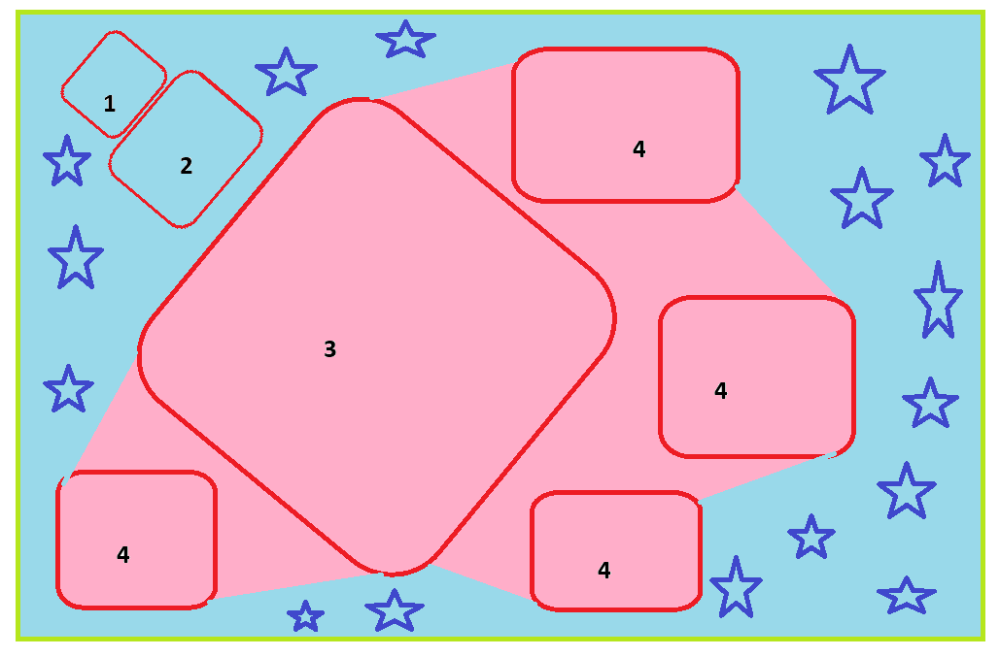
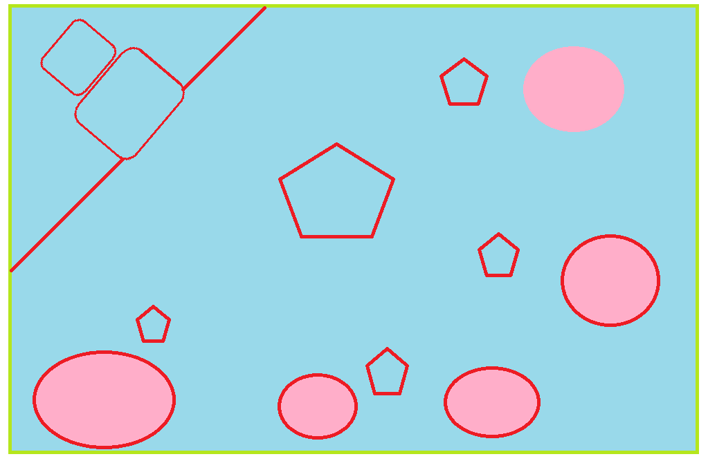

# Diseño base del juego

Qué existe dentro del juego y cómo se relaciona, antes de entrar en valores concretos (estadísticas, daño, tiempos). Documento vivo: se completa a medida que se toman decisiones.

## 1. El juego en una frase

MMORPG 3D para PC donde cada jugador hace evolucionar a su personaje a lo largo de temporadas (estilo Lineage 2), en un mundo con combate, profesiones, recolección y contenido PvE y PvP (estilo World of Warcraft).

## 2. Pilares de diseño

1. **El personaje evoluciona**: empieza sencillo y crece con especializaciones, subclases y equipo.
2. **Hay más que subir de nivel**: profesiones, recolección, mazmorras, jefes, PvP, economía.
3. **Temporadas**: el contenido se publica por etapas; cada una tiene su propio endgame.
4. **Todo cuesta moneda**: teletransporte, desarrollo, comercio, ampliaciones… Cada sistema retira moneda para frenar la inflación.
5. **Juego limpio**: el servidor decide todo lo importante (combate, botín, recolección) para combatir trampas y bots.
6. **Funciones que se desbloquean por nivel**: clan (nivel 10), bandas, eventos masivos… se abren a medida que el personaje progresa, para presentarlas poco a poco.

## 3. Entidades del mundo

Todo lo que existe en el mundo pertenece a una de estas familias.

```
Entidades del mundo
├── Personajes jugadores
├── NPCs de combate
│   ├── Mobs (monstruos)
│   └── Jefes
├── NPCs de interacción (no combaten)
├── Recursos recolectables
└── Objetos interactivos del mundo
```

### 3.1 Personajes jugadores

Los controla una persona.

- Clase de inicio (Mágica - Rango, Física - Melee, Física - Rango) → especialización 1 (nivel 20) → especialización 2 → especialización 3.
- **Del 1 al 19 solo existe la clase de inicio**: en el nivel 1 se elige daño mágico (**Mágica - Rango**) o daño físico (**Física - Melee** o **Física - Rango**). En el **nivel 20** una misión del entrenador de clase ofrece las clases base del arquetipo (detalle en `docs/ESTADISTICAS.md`, 1.7).
- Varias **subclases** por personaje, cada una con su propio progreso. Se desbloquean en el **nivel 60** (del 1 al 40 se aprende a jugar bien la clase; del 40 al 60 se sube rápido). Reglas detalladas: más adelante.
- Estadísticas principales (STR / INT / AGI), derivadas y neutrales.
- Recursos: vida, MP y un recurso secundario según la clase (Ira, Energía, Foco, Iluminación).
- Habilidades, equipo, inventario, profesiones, misiones y reputación.

**Cambio de clase / subclase (referencia MIR4, por confirmar al diseñar las subclases)**
- Pantalla con la **lista de clases**: las que el personaje ya tiene, las disponibles para crear y las bloqueadas.
- **Condiciones** para crear o cambiar: estar en una ciudad concreta, no estar en grupo ni banda, y que haya pasado el **tiempo de espera** del último cambio (10 minutos en MIR4).
- **Crear** una clase nueva cuesta recursos (en MIR4, 1 millón de cobre la primera) o un **ticket de creación**; el coste sube con cada clase creada. **Cambiar** entre clases ya creadas es gratis.
- Se comparten el **nivel** del personaje, las mejoras y las bolsas; **no** se comparten armas, armaduras ni habilidades (cada clase tiene las suyas).
- Algunas clases futuras podrían desbloquearse solo con un pago concreto (cobre, oro, otro recurso o dinero real).

**Equipo al cambiar de subclase (decidido)**
- **Conjunto de equipo por clase**: el jugador puede **vincular** un conjunto de piezas a cada clase (y actualizarlo cuando quiera). Al activar esa clase, el sistema se lo pone automáticamente.
- Si no hay conjunto vinculado, se equipa por defecto **el de mayor calidad** que tenga para esa clase.
- Si no tiene equipo para alguna ranura, esa ranura queda **vacía**.
- Las piezas sin tipo de armadura (capa, cintura, joyería) pueden compartirse entre clases, pero normalmente cada clase querrá las suyas por sus estadísticas (fuerza y defensa para un guerrero; intelecto, velocidad de lanzamiento y crítico mágico para un mago).

### 3.2 NPCs de combate — Mobs

Enemigos que pueblan el mundo y las mazmorras.

- Tienen nivel, estadísticas, habilidades y comportamiento (IA).
- **Categorías propuestas:**
  - **Normal**: enemigo común.
  - **Élite**: más fuerte, pensado para grupos o jugadores preparados.
  - **Raro**: aparece con poca frecuencia y da mejor botín.
- **Comportamiento:**
  - **Agresivo**: ataca al ver al jugador.
  - **Neutral**: solo ataca si lo atacan.
  - **Pasivo**: nunca ataca (animales, criaturas ambientales).
- Al morir dan experiencia y botín. Reaparecen tras un tiempo.
- Pueden ser fuente de recursos (pieles, carne, materiales) mediante profesiones.

**Familias de mobs (decidido)**: todo mob pertenece a una familia, que define su trofeo de códice y su basura. Temporada 1: **bestias, humanoides y elementales**; Temporada 2 añade **no-muertos**; Temporada 3, **insectos/arácnidos**; después, una familia nueva por temporada (candidatas: demonios, dragones, constructos…).

### 3.3 NPCs de combate — Jefes

Enemigos especiales con mecánicas propias (fases, habilidades únicas, ataques que hay que esquivar).

- **Jefe de mazmorra**: al final o a lo largo de una mazmorra, para grupos.
- **Jefe de mundo**: aparece en el mundo abierto cada cierto tiempo y reúne a muchos jugadores; puede generar PvP alrededor. Contenido de grupo principal de la Temporada 1.
  - **Escala su vida según quién le ataca**, como las bandas.
  - Si le ataca un jugador **que está en un grupo**, el jefe escala **de inmediato por todo el grupo** (los 5 miembros), aunque los demás no estén allí. Evita que miembros de un grupo esperen lejos y lleguen al final solo para llevarse parte del botín gracias al reparto por grupo.
- **Jefe de banda (raid)**: contenido de endgame para grupos grandes.
- Botín especial y, en algunos casos, ligado a la temporada.

### 3.4 NPCs de interacción

No combaten (o solo se defienden). El jugador habla o comercia con ellos.

| Tipo | Función |
|---|---|
| Dador de misiones | Da y recibe misiones |
| Comerciante | Compra y vende objetos |
| Entrenador de clase | Enseña habilidades, gestiona especializaciones y subclases |
| Entrenador de profesión | Enseña y sube de rango las profesiones |
| Banquero / almacén | Guarda objetos del jugador |
| Transporte | Viaje rápido entre zonas (teletransporte, monturas) |
| Herrero | Repara equipo |
| Guardia | Protege ciudades; puede combatir |
| Ambiental | Da vida al mundo (diálogos sueltos, sin función) |

Un mismo NPC puede tener varias funciones (por ejemplo, comerciante y dador de misiones).

### 3.5 Recursos recolectables

Puntos del mundo donde se obtienen materiales.

| Recurso | Profesión asociada | Ejemplos |
|---|---|---|
| Minerales | Minería | Cobre, hierro, plata, gemas |
| Plantas | Herboristería | Hierbas para pociones |
| Madera | Tala | Troncos para armas y construcción |
| Pesca | Pesca | Peces para cocina |
| Pieles / partes de mobs | Desuello | Cuero, colmillos, escamas |

Los materiales alimentan las profesiones de fabricación (herrería, alquimia, cocina, etc.). Los materiales útiles para el equipo de nivel alto solo los dan mobs y recursos de nivel alto.

Hay **dos sistemas de recolección** (decidido):

#### A. Zonas de recolección (estilo MIR4)

- Zonas concretas del mapa con muchos puntos de recolección (por ejemplo, 20 menas en una zona).
- Cada punto tiene un **grado** que define qué materiales da, en qué cantidad y con qué calidad (común, poco común, raro…).
- Cada punto tiene una **cantidad de cargas** (pueden ser cientos). Cada "golpe" de recolección gasta carga y da uno o varios materiales.
- **Uso exclusivo**: solo una persona puede recolectar un punto al mismo tiempo.
- Al agotarse las cargas, el punto desaparece y **reaparece** tras un tiempo.

#### B. Vetas enriquecidas (estilo WoW)

- Versión especial y escasa de un recurso (por ejemplo, "veta de cobre enriquecida"): **materiales mejores y en mayor cantidad**, pero **pocas cargas** (por ejemplo, 10).
- **Compartidas y por jugador**: cualquier jugador cercano puede recolectarla a la vez, y **cada jugador** puede sacar todas las cargas de la veta (si llegan 30 personas, las 30 recolectan).
- La **cuenta atrás** (por ejemplo, **1 minuto**) empieza en el **primer golpe** de cualquier jugador. Durante ese minuto todos pueden recolectar; al terminar, la veta desaparece para todos. **Agotar las cargas no la hace desaparecer**: solo el tiempo.
- **Cargas individuales**: cada jugador ve y gasta **sus propias** cargas; para todo el que llega la veta siempre muestra las cargas completas (si yo saco 9, el siguiente sigue viendo 10, no 1).
- **Velocidad de recolección**: cada golpe tarda un tiempo que mejora con el progreso del personaje (por ejemplo, 2 s por carga al principio → la veta de 10 cargas se vacía en 20 s; más adelante 1 s → 10 s). Un recolector rápido vacía su parte y se va a buscar otra veta, mientras la veta sigue disponible para los demás hasta que termine el minuto.
- **Aparición aleatoria** entre muchos puntos posibles de la zona (por ejemplo, 70 puntos posibles, máximo 10 vetas activas a la vez, reaparición cada ~5 min).
- Objetivo: que los jugadores aprendan los puntos, creen rutas de recolección y avisen a sus amigos para recolectar juntos.

Todos los valores (cargas, tiempos, cantidades, probabilidades) son datos ajustables.

**Ampliado en el capítulo de estadísticas** (`docs/ESTADISTICAS_NEUTRALES.md`, 7): 10 s por recogida de base; velocidad de recolección general (cada 100 % reduce el tiempo a la mitad); minería y herboristería suben por puntos como en WoW y a 100 puntos dan +25 % cada una; las vetas enriquecidas piden 50 puntos, dan el material del grado más alto de la temporada en mayor cantidad y solo se recogen 1–3 veces (sustituye las ~10 cargas de arriba); la energía no tiene profesión ni vetas enriquecidas y da una cantidad según la calidad del punto.

### 3.6 Objetos interactivos del mundo

Elementos con los que se puede interactuar y que no son NPCs ni recursos.

- Cofres (botín), puertas y palancas, portales, puntos de resurrección, objetos de misión, carteles o tablones de misiones.

### 3.7 Botín de un mob (decidido)

Cada mob tiene una **tabla de botín** con dos partes. Ejemplo, un lobo:

| Tipo | Recompensa | Cantidad / probabilidad | A quién le llega | Apilable | Tamaño de pila |
|---|---|---|---|---|---|
| **Fijo** | Experiencia | Cantidad exacta | Repartida según contribución | — | — |
| **Fijo** | Moneda | Cantidad exacta | Repartida según contribución | — | — |
| **Variable** | Armaduras del grupo | % (baja) | Para el grupo: armadura de **cualquier clase**, a un miembro al azar | No | — |
| **Variable** | Armaduras individuales | % (p. ej. 30 %) | **Individual**: solo de la clase del personaje | No | — |
| **Variable** | Objetos de misión | % | **Individual**: solo a quien tenga la misión activa | Sí | Por definir |
| **Variable** | Objetos de profesión | % | Para todos por igual (rotación) | Sí | Por definir |
| **Variable** | Objetos de códice | % | Para todos por igual (rotación) | Sí | Por definir |
| **Variable** | "Basura" (objetos para vender) | % | Para todos por igual (rotación) | Sí | Por definir |

**Apilables**: el equipo (armas, armaduras, joyería) no se apila; cada pieza ocupa su propio espacio. El resto de objetos se apila; el tamaño máximo de cada pila se definirá con el inventario.

Los valores concretos de cada mob se definirán más adelante en las tablas de datos.

### 3.8 Reparto de recompensas (decidido)

**No existe "el primero que golpea se lo queda"** (sin mobs "grises" estilo WoW). La **contribución** es el **daño efectivo** hecho al mob: si el mob tiene 500 de vida y el golpe final es de 5.000, cuentan 500.

**Entre jugadores o grupos distintos** que atacan al mismo mob, **todo** se reparte según la contribución, incluidas las armaduras individuales. Ejemplo: el grupo 1 hace el 80 % del daño y el grupo 2 el 20 %:

| | Grupo 1 (80 % del daño) | Grupo 2 (20 % del daño) |
|---|---|---|
| Fijos (experiencia, moneda) | 80 % | 20 % |
| Armaduras del grupo | 80 % de probabilidad | 20 % de probabilidad |
| Armaduras individuales | Cada miembro: su % × 0,8 | Cada miembro: su % × 0,2 |
| Objetos de misión | 80 % de probabilidad | 20 % de probabilidad |
| Objetos de profesión | 80 % de probabilidad | 20 % de probabilidad |
| Objetos de códice | 80 % de probabilidad | 20 % de probabilidad |
| "Basura" | 80 % de probabilidad | 20 % de probabilidad |

- **Fijos**: reparto exacto. Mob de 300 XP: 240 para el grupo 1 y 60 para el grupo 2. La moneda se reparte en la unidad mínima (cobre); lo que no llegue a 1 cobre se pierde.
- **Variables**: cada objeto tira su probabilidad de caer; si cae, un marcador interno decide a qué unidad (jugador o grupo) va, con la contribución como probabilidad.
- **Excepción — armaduras individuales**: cada jugador tira su propia probabilidad multiplicada por la contribución de su unidad. Con un 30 % base: en el grupo 1 (80 %) cada miembro tiene 24 %; en el grupo 2 (20 %), 6 %.
- Un **grupo cuenta como una sola unidad**; un jugador sin grupo es una unidad propia. Funciona igual en mobs normales y en jefes de mundo o de banda.
- Solo cuenta el **daño efectivo**: si el mob tiene 500 de vida y el golpe final es de 5.000, cuentan 500.
- **Sin contribución mínima** y **sin penalización por diferencia de nivel**: los materiales valiosos solo los dan mobs de nivel alto.

**Moneda**: cobre, plata y oro (ver 3.20).

**Aggro**: estadística aparte, independiente del reparto. Los tanques generan más aggro con sus habilidades y estadísticas.

### 3.9 Grupos y bandas (decidido)

El juego está pensado para **jugarse en grupo**: jugar acompañado siempre debe rendir más que jugar solo.

**Grupo**: máximo **5 personas**. Es la única agrupación que recibe bonus de experiencia y moneda.

| Miembros | Bonus de experiencia |
|---|---|
| 1 (solo) | — |
| 2 | +10 % |
| 3 | +15 % |
| 4 | +20 % |
| 5 | +25 % |

- **Bonus de moneda**: existe y crece con el tamaño del grupo; valores por definir (orientativo: +5 %, +10 %, +15 %, +20 %).
- **Banda (raid)**: agrupación grande y **flexible, de 10 a 40 personas** (ver 3.30). Sin bonus de experiencia.

#### Reparto dentro del grupo (decidido)

- **Experiencia y moneda**: a partes iguales entre los miembros, más el bonus de grupo.
- **Objetos**: se reparten **por rotación con prioridad**.

**Orden de prioridad** (de mayor a menor):

1. Armaduras del grupo
2. Armaduras individuales
3. Objetos de misión
4. Objetos de profesión
5. Objetos de códice
6. "Basura"

**Algoritmo**

1. Se tira la probabilidad de cada categoría para saber qué cae.
2. Se recorren los objetos caídos en orden de prioridad. Cada uno se entrega **al azar** a un miembro **no excluido**.
   - **Excepción — armaduras individuales**: no se sortean. **Cada miembro no excluido** tira su propia probabilidad, y todos los que acierten reciben una (del tipo de su clase). Pueden caer varias en una muerte.
   - **Nadie recibe dos armaduras en la misma muerte**: quien recibió la armadura del grupo no tira por la individual.
   - **Excepción — objetos de misión**: quedan **fuera del sorteo de rotación**. Solo pueden ir a miembros que tienen la misión activa y aún necesitan el objeto (al azar entre ellos), **sin importar la exclusión**, y recibirlo no excluye de lo que sigue. Un objeto de misión nunca se pierde por la rotación.
3. Quien recibe un objeto queda **excluido** de los siguientes.
4. Cuando los 5 miembros han recibido algo, la exclusión se reinicia y todos vuelven a estar habilitados.
5. Termina cuando no quedan objetos.

*(En los ejemplos 1 y 2, solo un miembro acierta su tirada de armadura individual.)*

**Ejemplo 1 — caen 4 objetos** (armadura del grupo, armadura individual, códice, basura):
armadura del grupo → jugador 3 · armadura individual → jugador 5 (excluido 3) · códice → jugador 2 (excluidos 3, 5) · basura → jugador 4 (excluidos 3, 5, 2). Fin.

**Ejemplo 2 — caen 6 objetos** (todas las categorías):
armadura del grupo → jugador 2 · armadura individual → jugador 4 · misión → jugador 1 · profesión → jugador 5 · códice → jugador 3 · todos recibieron: se reinicia la exclusión · basura → jugador 4. Fin.

**Ejemplo 3 — varias armaduras individuales** (armadura del grupo, armaduras individuales, códice, basura):
armadura del grupo → jugador 3 · los jugadores 1, 2, 4 y 5 tiran su armadura individual; aciertan 5, 4 y 2 → una armadura para cada uno · códice → jugador 1 (único no excluido) · todos recibieron: se reinicia la exclusión · basura → jugador 4. Fin.

**Notas por tipo de objeto**

- **Armaduras del grupo**: probabilidad baja; armadura de **cualquier clase**. Permite conseguir armaduras de clases que no hay en el grupo (por ejemplo, de mago en un grupo sin magos) para los códices de otras clases. Se pueden comerciar o vender en el mercado.
- **Armaduras individuales**: siempre del tipo propio de la clase de quien la recibe. Su probabilidad se ajusta por la contribución del grupo (3.8). Es la fuente principal para el códice de la propia clase.
- **Objetos de misión**: en cada muerte cae como máximo uno para el grupo, así que una misión tarda **lo mismo sola que en grupo** (en grupo se necesitan más objetos, pero se matan más mobs). Si nadie del grupo necesita el objeto, no cae.

### 3.10 Roles (decidido)

- **Todas las clases y especializaciones pueden hacer daño** y jugar solas, incluidas las de tanque y sanador.
- En grupo, cada especialización es más eficiente en su rol: el tanque aguanta y atrae a los mobs, el sanador cura, el DPS hace daño.
- Habrá zonas pensadas para grupos (por ejemplo, muchos mobs agresivos) donde un tanque y un sanador hacen que subir de nivel sea mucho más rápido.

### 3.11 Códice (estilo MIR4 — detalle en un capítulo propio más adelante)

Sistema de colección que da **estadísticas permanentes a la cuenta**. Por ahora solo se fija lo básico:

- **Los mobs sueltan trofeos**, el material del **códice de caza** (objetos de códice en la tabla de botín). *"Trofeo" es el nombre provisional; se descarta "insignia" por ser demasiado de MIR4.*
- **Trofeos representativos de cada familia de mob**: no son objetos inventados, sino una parte de la criatura que se caza. Ejemplos: las **bestias** sueltan **dientes**; los **elementales**, **residuo elemental**. Solo cazando esa familia se consigue su trofeo.
- **Objetos de códice**: se fabrican con los trofeos y llevan su nombre (con dientes, un **collar de dientes**; con residuo elemental, un **collar de residuo elemental**).
- **Las familias de mobs se introducen por temporada**, y con ellas sus entradas del códice de caza:
  - **Temporada 1**: bestias, humanoides y elementales.
  - **Temporada 2**: + no-muertos.
  - **Temporada 3**: + insectos/arácnidos.
  - Siguientes temporadas: una familia nueva cada vez.
- El códice de caza **crece con cada temporada** y lo anterior **nunca se pierde ni queda obsoleto**: las entradas antiguas siguen sumando y sus trofeos se pueden seguir cazando en las zonas anteriores. Conviene guardar trofeos.
- Los nombres concretos de cada trofeo y objeto se definirán al diseñar los mobs y su botín.
- **Cada temporada trae un trofeo nuevo por familia** (por ejemplo, bestias: dientes en la Temporada 1 → huesos en la Temporada 2 → …), manteniendo la forma "collar de X".
- La **basura** también es temática y sencilla (lobos: bolas de pelo; alces: cuernos desgastados…).
- Con los trofeos se **fabrican** objetos de códice, que se **mejoran** y se **registran**. Fabricación, mejora y niveles de las entradas: por definir.
- **Registro**: el objeto **se consume** y desaparece del inventario; queda registrado en la cuenta. Cada línea del códice necesita sus objetos concretos: un objeto no cubre varias líneas.
- **Códice de armaduras**: las armaduras sobrantes o sustituidas también se registran, en vez de venderse por poco. Cuando el códice está completo, las armaduras de más se mejoran y se venden en el mercado.
- **Bonificaciones de cuenta**: se mantienen al cambiar de subclase (el códice de ataque mágico sigue sirviendo si un guerrero pasa a mago).
- **Todas las estadísticas suman para todas las clases**, a diferencia de MIR4: el ataque mágico también ayuda a un guerrero, pero mucho menos que a un mago. Se definirá en el capítulo de estadísticas.

Inspiración (MIR4): material por zona con grados, combinable y ligado → objeto de códice (material + moneda) → mejora (p. ej. +2) → entrada que pide un conjunto de objetos → bonificación fija → efectos totales sumados.

**Pestañas del códice (decidido)**

| Pestaña | Qué se registra | Alcance |
|---|---|---|
| **Personaje** | Solo el equipo que **mi clase/especialización puede usar** (un guerrero tanque solo ve equipo de guerrero tanque; nunca equipo de mago) | Del personaje |
| **Caza** | Objetos de códice fabricados con **trofeos** de cada familia de mob | **Compartido** por todos los personajes de la cuenta en el servidor: lo que registra uno, lo tienen todos |
| **Servidor** | Equipo de **otras clases y especializaciones** (por ejemplo, armaduras de mago para un guerrero). Da pocas estadísticas, pero suma | **Compartido** por todos los personajes de la cuenta en el servidor |
| ~~Tiempo limitado~~ | — | **No se implementa nunca** (códices temporales de MIR4) |

- El códice de servidor da salida a las piezas de otras clases que caen (armadura de grupo, 3.9): se registran o se venden a quien las necesite.
- **Cambio de servidor (más adelante)**: al trasladar un personaje a otro servidor, los códices compartidos se los lleva ese personaje y los personajes alternativos del servidor de origen los pierden. Habrá una opción para elegir **qué personaje** se queda con lo compartido y **qué se lleva** en el traslado (oro, códices, etc.).
- **Proporción de entradas** (referencia MIR4): Personaje ~1.800, Caza (en MIR4, "Reputación") ~350, Servidor ~290 (≈ 74 % / 14 % / 12 %). La pestaña Personaje es la más grande porque el equipo de la propia clase es lo que más se recoge; las otras dan menos estadísticas en total.
- **Subclases**: la pestaña Personaje tiene **las mismas entradas y bonificaciones** para todas las clases, pero los **objetos que pide cada entrada cambian** según la **clase activa** (al pasar de guerrero a taoísta, las casillas piden equipo de taoísta). Lo ya registrado **se mantiene** y sus estadísticas siguen sumando.
- **Panel de progreso** por pestaña: entradas completadas / total, porcentaje, en curso y completadas.
- Botón **Efectos**: muestra las estadísticas totales obtenidas por cada pestaña y el total general del códice.
- **Tipos de bonificación** (referencia MIR4, a definir en el capítulo de estadísticas): estadísticas planas (vida, maná, ataque y defensa física/mágica, precisión, evasión, crítico, evasión de crítico) y porcentuales (daño crítico, reducción de daño crítico, reducción de todo el daño, experiencia de caza, obtención de energía…). Las de Personaje son las más altas; las de Servidor, las más bajas.
- En MIR4 algunas entradas de la pestaña Personaje piden objetos que no son equipo (gemas, objetos de espíritus…). Para nuestro juego, de momento, el códice solo pide equipo y objetos hechos con trofeos.

**Qué pide cada entrada (decidido)**
- Las entradas se agrupan por **estadística** y se numeran ([1], [2], [3]…). Todas las de un grupo dan **la misma bonificación** (por ejemplo, ataque físico +20 cada una).
- Cada entrada siguiente pide **más objetos** y **más desarrollo**. Ejemplo: [1] → 2 piezas a +4; [2] → 4 piezas a +6; [3] → 6–8 piezas a +8.
- Así la misma estadística se consigue varias veces, cada vez con más esfuerzo.
- Las cantidades exactas por calidad y pestaña se fijarán con el capítulo de estadísticas.

**Interfaz del códice (referencia MIR4)**
- Lista de **entradas**; cada una con nombre y nivel ("[1]", "[6]"…), la bonificación que da (por ejemplo, ataque físico +20) y los **objetos que pide**, cada uno con el **nivel de desarrollo requerido** (+7, +8…).
- Filtro lateral: **favoritos** (estrella), **todos** y **por calidad** (poco común, raro, épico, legendario…). Filtros superiores: estadística, rango de desarrollo, grado y buscador por nombre.
- Panel de **efectos totales** con la suma de todas las bonificaciones.
- Botones de **registro automático** y **progreso**.
- **Estados visuales de cada objeto pedido**:
  1. **No lo tengo**: casilla vacía o apagada.
  2. **Lo tengo pero no está desarrollado** al nivel pedido: icono de aviso (círculo naranja con "!").
  3. **Lo tengo desarrollado**: casilla iluminada, lista para registrar.
  4. **Registrado**: marca o sello de completado.

**Crecimiento del códice con el juego**
- Cada vez que salga una **clase nueva** o **piezas de equipo nuevas**, se añaden entradas de códice para todas las calidades.
- **Cada temporada** trae sus propias entradas de códice.

**Botín y códice dentro de una temporada** (ejemplo: Temporada 3, niveles 40–60)
- Los mobs de la parte baja de la temporada (nivel 40) sueltan mucho equipo **común y poco común**: alimento para el códice.
- A medida que se acerca al nivel máximo (60), empieza a caer equipo de calidad más alta.
- La **calidad máxima de la temporada** (por ejemplo, épico en la Temporada 3) **no se consigue fácil como botín**: es equipo de **fabricación** con componentes recolectados. (El usuario explicará más adelante el cuello de botella de MIR4 y cómo evitarlo.)

### 3.12 Objetos: clasificación (en curso)

#### Fuente (de dónde sale un objeto)

Es la primera clasificación de todo objeto.

| Fuente | Ejemplos |
|---|---|
| Caza | Botín de mobs y jefes |
| Misión | Recompensas de misiones |
| Fabricación | Profesiones, objetos de códice hechos con trofeos |
| Compra a NPC | Comerciantes |
| Logros | Recompensas por cumplir objetivos |
| Recolección | Minerales, plantas, madera, pesca |
| Eventos | Recompensas de eventos temporales o de temporada |
| PvP | Recompensas de arenas y zonas PvP |
| Cofres del mundo | Cofres y objetos interactivos |

El comercio entre jugadores y el mercado no crean objetos, solo los mueven, así que no son una fuente.

#### Calidad

| Calidad | Color |
|---|---|
| Común | Gris |
| Poco común | Verde |
| Raro | Azul |
| Épico | Rojo |
| Legendario | Amarillo |
| Mítico | Morado |
| Cósmico | Cian |

La calidad máxima disponible sube con cada temporada:

| Temporada | Niveles | Calidad máxima |
|---|---|---|
| 1 | 1–20 | Poco común |
| 2 | 20–40 | Raro |
| 3 | 40–60 | Épico |
| Siguientes expansiones | — | Legendario, Mítico, Cósmico |

#### Tipos de armadura (decidido)

Solo tres tipos: **tela**, **cuero** y **placas** (sin malla). Regla para asignar el tipo a cualquier clase, actual o futura:

| Tipo | Quién lo usa | Concepto |
|---|---|---|
| **Tela** | Clases de **daño mágico** | Magos, invocadores, sanadores mágicos |
| **Placas** | Clases físicas **de primera línea** | Tanques y luchadores que aguantan al frente pegando (bruisers, gladiadores) |
| **Cuero** | Clases físicas **que evitan el combate directo** | Arqueros, pícaros, asesinos: golpear rápido y desaparecer |

- **Niveles 1–20**: clases mágicas en tela y clases físicas en cuero (las placas llegan con las especializaciones).
- **Cualquier personaje puede llevar cualquier tipo**, pero el tipo propio de su clase le da una **bonificación de especialización en armadura** (por ejemplo, +1 % de agilidad con cuero). Con otro tipo la pierde.
- La armadura individual del botín (3.7) cae siempre del tipo propio de la clase del personaje.
- Bonificaciones por conjunto o por pieza: se definirán junto con los objetos y las estadísticas.

**Propuesta de asignación según el árbol de clases** (borrador; se revisará al diseñar el contenido de cada temporada):

| Especialización 1 (1–20) | Especialización 2 (20–40) | Especialización 3 (40–60) |
|---|---|---|
| Luchador — cuero | Dos manos — placas | Lancero — placas · Guerrero — placas |
| | Espadas duales — **?** | Gladiador — placas · Danzador — cuero |
| | Tanque — placas | Paladín — placas · Guardián — placas |
| Asesino — cuero | Daguero — cuero | Sutileza — cuero · Sanguinario — cuero |
| | Cazarrecompensas — cuero | Asesino — cuero · Mutilador — cuero |
| Combatiente — cuero | Frenético — placas | Berserker — placas |
| | Recolector — **?** | Carroñero — **?** · Explorador — cuero |
| Atacante a distancia — cuero | Arquero — cuero | Ballestero, Cazador, Francotirador — cuero |
| Mago — tela | Hechicero, Chamán — tela | Piromántico, Arcanista, Elementalista, Brujo, Alquimista — tela |
| Invocador — tela | Encantador — tela | Sacerdote, Conjurador, Nigromante, Bardo, Monje — tela |

#### Ranuras de equipo (decidido)

Dos grupos: **equipo** (ropa y armas) y **joyería**, con **8 ranuras cada uno**: **4 disponibles del nivel 1 al 40 y 4 que se desbloquean del 41 al 60**. La distribución es simétrica a propósito, para que la interfaz quede equilibrada (4 a cada lado) y no haya que rehacerla al añadir ranuras, como le pasó a MIR4.

| Grupo | Ranura | Tipo (tela/cuero/placas) | Apariencia | Disponible |
|---|---|---|---|---|
| Equipo | Arma | No | Sí | Nivel 1 |
| Equipo | Pecho | **Sí** | Sí | Nivel 1 |
| Equipo | Arma secundaria | No (depende de la clase) | Sí | Nivel 1 (objetos desde el nivel 21) |
| Equipo | Pantalón | **Sí** | Sí | Nivel 1 |
| Equipo | Guantes | **Sí** | Sí | Nivel 41 |
| Equipo | Botas | **Sí** | Sí | Nivel 41 |
| Equipo | Cintura | No | Sí | Nivel 41 |
| Equipo | Espalda | No | Sí | Nivel 41 |
| Joyería | Collar | No | Sí | Nivel 1 |
| Joyería | Anillo | No | Sí | Nivel 1 |
| Joyería | Arete | No | Sí | Nivel 1 |
| Joyería | Brazalete | No | Sí | Nivel 1 |
| Joyería | Tiara | No | Sí | Nivel 41 |
| Joyería | Anillo 2 | No | Sí | Nivel 41 |
| Joyería | Arete 2 | No | Sí | Nivel 41 |
| Joyería | Brazalete 2 | No | Sí | Nivel 41 |

- 16 ranuras en total: 8 hasta el nivel 40 y 8 más desde el 41.
- **Joyería duplicada**: no se pueden llevar dos piezas idénticas (dos anillos, aretes o brazaletes iguales). Cada pieza de joyería tiene **estadísticas aleatorias** dentro de unos rangos (mínimo y máximo por estadística), así que cada pieza es única. Más adelante habrá **conjuntos** (por ejemplo, el del "Furioso") con bonificaciones por llevar varias piezas.
- **Arma secundaria**: la ranura está abierta desde el nivel 1 por simetría, pero las armas secundarias (escudo, carcaj, frasco, libro…) solo caen desde el nivel 21, con la primera especialización.
- Piezas con tipo de armadura: pecho y pantalón (nivel 1–40); guantes y botas (desde el 41).
- Solo **pecho, guantes, pantalón y botas** tienen tipo de armadura: son las piezas que cuentan para la bonificación de especialización en armadura.
- **Sin casco ni hombreras**, a propósito: muchos jugadores ocultan el casco para lucir la cara que personalizaron. La cabeza queda despejada; la **tiara** es la pieza de cabeza (pequeña, no tapa el rostro).
- **Todas las ranuras tienen apariencia**, joyería incluida: los jugadores detallistas pueden coordinar colores (por ejemplo, joyería de amatista azul a juego con un conjunto azul).
- **Desbloqueo de apariencias**: al obtener un objeto por cualquier vía (botín, mercado, intercambio, recompensa…) se desbloquea su apariencia para el personaje. Prestarse objetos para conseguir la apariencia y devolverlos está permitido. También habrá apariencias de eventos.
- **Transfiguración**: la apariencia de una pieza se puede cambiar por otra. Sirve también para cosméticos de eventos (por ejemplo, transformar la tiara en un sombrero de vaquero).

**Referencia de interfaz (MIR4)**: pantalla de personaje con pestañas separadas para equipo y joyería; las ranuras rodean al modelo 3D y cada una muestra su calidad (color), grado (I, II, III…) y nivel de desarrollo (+5, +6…).

### 3.13 Comercio entre jugadores (decidido)

- Los intercambios directos entre jugadores **siempre cobran una comisión en oro**: no se pueden pasar objetos gratis.
- **Quema en cada transacción entre jugadores**: una parte de lo pagado **desaparece de la economía**. Ejemplo: quien paga entrega 300 de oro y quien cobra recibe 280; los 20 restantes se queman.
- **El intercambio directo (P2P) se premia** con una comisión **menor que la del mercado** (ejemplo: 20 en P2P frente a 200 en el mercado por la misma operación).
- El mercado y el comercio no crean objetos, solo los mueven (ver Fuentes en 3.12).

### 3.14 PvP (decidido)

- **Dos tipos de zona** en un único tipo de servidor (sin servidores separados PvE y PvP):
  - **Zonas de combate (PvP)**: PvP libre. Matar a otros jugadores **no da karma**; da **honor**.
  - **Zonas seguras**: se **puede** atacar a otros jugadores, pero quien mata **gana karma** (estilo Lineage 2), con sus consecuencias (ver 3.22).
- Cada jugador decide si entra a las zonas peligrosas a pelear por recursos.
- **PvP en campo abierto, estilo Lineage 2** (no solo en campos de batalla como WoW): grupos y clanes pelean por **controlar territorios** y sus recursos. Morir en PvP también quita experiencia, lo que hace que controlar una zona importe.
- Las zonas PvP dan **botín especializado en PvP** (objetos que mejoran estadísticas PvP); las zonas PvE dan botín enfocado al PvE.

### 3.15 Profesiones (decidido, estilo WoW)

- **Todas las profesiones disponibles desde el nivel 1** (Temporada 1 incluida).
- **2 profesiones principales** por personaje y **todas las secundarias** que se quieran.

| Principales (elegir 2) | Secundarias (todas) |
|---|---|
| 1. Sastre | Cocinero |
| 2. Peletero | Desollador |
| 3. Herrero | Minero |
| 4. Joyero | Herborista |
| 5. Encantador | Pesca |
| 6. Inventor | |

- **Cambio de profesión principal**: solo hay **2 principales activas** a la vez, pero ninguna se olvida. Para aprender otra, se habla con el entrenador de la nueva profesión y se elige cuál de las dos activas se **inhabilita** (queda guardada con su progreso y se puede reactivar más tarde).
  - Cada cambio cuesta **oro**, y el coste **sube con cada cambio** siguiendo una curva suave (logarítmica, no exponencial). Objetivo: que se cambie cuando de verdad hace falta, no ir subiendo todas a la vez saltando de una a otra.
- **Inventor — cómo se obtiene**: al convertirse en **Recolector** (nivel 20) aparece una misión que ofrece la profesión de inventor; para aprenderla, el jugador elige cuál de sus dos principales inhabilitar. **Nunca hay más de 2 principales activas**, tampoco para el Recolector.
- **Inventor**: profesión de artesano avanzado, inspirada en los enanos artesanos de Lineage 2 (personajes dedicados a fabricar cosas muy potentes más que a cazar). Es la única que fabrica **piedras santificadas**. **Exclusiva de la rama Recolector** (Combatiente → Recolector → Carroñero / Explorador): una clase pensada para quien quiere centrarse en recolectar y fabricar en vez de cazar.
- **Encantador**: profesión separada, la única que fabrica **papiros de encantamiento** (sección 3.19). **No fabrica piedras de desarrollo**. Un jugador puede combinarla con otra principal (por ejemplo, sastre + encantador).
- Detalle de cada profesión (recetas, niveles, qué fabrica): capítulo propio más adelante.

### 3.16 Monturas (decidido)

- **Solo terrestres** (sin monturas voladoras).
- Todas funcionan igual: el personaje se sube y gana velocidad de movimiento. Lo que cambia es la **apariencia** (caballos, bicicletas, motos…).

### 3.17 Inventario (en curso)

Objetivo: que el inventario **nunca sea una fuente de frustración** (llenarse de objetos inútiles, tener que volver a la base a vender).

**Venta directa desde el inventario** (estilo MIR4): se selecciona el objeto y se vende, sin NPC. Ir a un NPC solo tiene sentido para **intercambiar** objetos por otra cosa, no para venderlos por moneda.

**Bolsas**: un inventario **general** y **dos bolsas especiales**, cada una en su propia casilla.

**Casillas de bolsa**

| Casilla | Básicas | De pago (oro, precio alto) | Máximo |
|---|---|---|---|
| **Bolsa principal** | 1 — no se puede vender, quitar ni cambiar; se **amplía con oro** | — | 1 |
| **Bolsas normales** | 3 — se desbloquean con **misiones** | 4.ª y 5.ª | 5 |
| **Bolsa de componentes** | 1 | 1 más | 2 |
| **Bolsa de consumibles** | 1 | — (siempre una sola) | 1 |

Máximo total: 9 bolsas.

| Bolsa | Qué guarda | Cómo se llena |
|---|---|---|
| **General** | Equipo, basura y todo lo que no cabe en las especiales | Automático |
| **Componentes** | Todo lo que sirve para fabricar (componentes de profesiones principales y secundarias, trofeos del códice…) | Automático |
| **Consumibles** | Pociones de vida y de maná, elixires, comidas | **El jugador decide** qué pone en cada espacio (por ejemplo, de 10 espacios: 6 de pociones, 2 de comida, 1 de elixir y 1 libre) |

- **Desbordamiento**: si una bolsa especial está llena, lo que llega va a la **bolsa general**. **Nunca se pierde un objeto** por falta de espacio en una bolsa especial.
- Ventaja: inventario ordenado, y es imposible vender por accidente los componentes.

**Terminología**: **componentes** = cualquier objeto que se usa para fabricar algo, sea de profesión principal o secundaria.

**Objetos de misión — "bolsa invisible"**: no ocupan espacio ni se muestran en el inventario. Solo se ven como progreso en el **registro de misiones** (por ejemplo, "Pieles de lobo 3/5"). Se eliminan al completar o abandonar la misión. Así nadie se bloquea por tener el inventario lleno, y quien acepte muchas misiones sin terminarlas no acumula miles de objetos visibles.

**Tamaño de las pilas**: lo define **cada objeto** al crearlo, según su calidad y lo frecuente que sea. Los objetos muy abundantes (por ejemplo, trofeos del códice, de las que se acumulan 10.000–20.000) tienen pilas muy grandes para no ocupar espacio.

**De dónde salen las bolsas**:
- La fuente principal son las **profesiones**: cada profesión puede fabricar una bolsa mayor usando **solo sus propios materiales** (el desollador con componentes de desuello, el encantador con componentes de encantamiento…). Así cualquier jugador que suba una profesión puede hacerse una bolsa.
- Los jugadores **especializados en profesiones** pueden fabricar bolsas un poco más grandes (por ejemplo, de 34 a 36 o 38 espacios): una ventaja pequeña, no abismal.

**Desbloqueo progresivo, ligado a la introducción del juego**:
- Niveles 1–3: los mobs solo dan **experiencia y cobre**; el jugador aprende lo básico sin llenar el inventario.
- Al llegar al nivel 3, un NPC de misión presenta las **profesiones** y desbloquea la **casilla de la bolsa de componentes**.
- Al avanzar en el juego se desbloquean **más casillas** y se consiguen **mejores bolsas**.

**Organizar bolsas** (referencia: botón "Limpiar bolsas" de WoW): botón con icono de brocha en la bolsa general que ordena todo automáticamente:
- Lo **útil** se coloca empezando por la **esquina inferior derecha**, de abajo hacia arriba y de derecha a izquierda.
- La **basura** se coloca empezando por la **esquina superior izquierda**, de arriba hacia abajo y de izquierda a derecha.
- Así la basura queda agrupada en un extremo y lo útil en el otro.
- Orden dentro de lo útil: **por categoría** (equipo, consumibles, componentes…) y dentro de cada una **por calidad**, de mayor a menor.

**Asignar bolsas** (referencia: WoW): una bolsa del inventario general puede convertirse en bolsa **solo para un tipo** de objeto. Es una **recompensa de profesiones**:
- Al llevar la **primera profesión principal al máximo** → se pueden asignar bolsas a **componentes**.
- Al llevar **una profesión secundaria al máximo** → se pueden asignar bolsas a **consumibles**.
- Ejemplo: quien pasa una tarde minando o fabricando en masa tiene sus componentes siempre ordenados en las mismas bolsas.
- *Propuesta por confirmar*: opciones por bolsa para excluirla del botón de organizar y de la venta rápida (como "Ignorar esta bolsa" en WoW).

**Venta rápida** (referencia: MIR4):
- Panel de **lista de venta** junto al inventario: muestra cuántos objetos van seleccionados y permite elegir la cantidad a vender de cada pila.
- **Filtros de selección automática**: por calidad (común, poco común, raro…) y si se incluyen o no objetos comerciables.
- Botones: **selección automática** (aplica los filtros), **reiniciar** y **vender**.
- **Bloqueo de objetos**: el jugador puede bloquear cualquier objeto (candado) para que nunca entre en la venta rápida.
- *Propuestas por confirmar*: filtro por categoría (basura, equipo, componentes…); que la selección automática **excluya el equipo que aún falta registrar en el códice**; mostrar el total de moneda antes de confirmar.

**Banco** (referencia: WoW):
- **Banco personal**: uno por personaje, organizado en **pestañas**.
  - **Pestaña 1 — general**: guarda cualquier tipo de objeto.
  - **Pestaña 2 — componentes**: solo componentes.
  - **Pestañas adicionales**: se compran (como las casillas de bolsa) y, al desbloquearlas, el jugador decide si quedan abiertas a todo o asignadas a un tipo de objeto.
- Comodidades: buscador, botón de organizar y botón **"Depositar todos los componentes"**.
- **Banco de tropa** (compartido entre los personajes de la cuenta): la pestaña existe pero se desbloquea en el **nivel 60**, cuando llega el contenido para varios personajes en la cuenta (por ejemplo, clases especiales que se añadan más adelante).

### 3.17b Fabricación de equipo y cuello de botella (decidido el principio)

**Cómo funciona en MIR4 (referencia)**
- Para fabricar equipo de una calidad hacen falta **componentes de esa misma calidad** (por ejemplo, un arma épica pide acero épico, orbes épicos, etc., además de moneda).
- Los componentes se pueden **combinar hacia arriba**: 10 de una calidad → 1 de la siguiente.
- Interfaz: pestañas por tipo (arma/arma secundaria, armadura, accesorios), lista por calidad, receta con los componentes y su cantidad, y filtro "se puede fabricar".

**El cuello de botella de MIR4**
- Por mucho que avance el jugador, los mobs solo sueltan componentes hasta **raro**, la recolección hasta **épico** y los cofres hasta **legendario**.
- Para un objeto **mítico** hay que combinar desde abajo: 10 legendarios = 100 épicos = 1.000 raros = 10.000 poco comunes. Llegar a la calidad más alta se vuelve casi imposible, y subir de nivel no ayuda.

**Solución para nuestro juego**
- **Cada temporada, los mobs de mayor nivel sueltan componentes de la calidad máxima de esa temporada** (por ejemplo, en la Temporada 3, los mobs de nivel 60 sueltan acero épico).
- La probabilidad debe estar **equilibrada**: ni un componente por cada mob (el equipo saldría demasiado rápido) ni uno cada miles (frustrante).
- Objetivo: que el equipo y el códice de la temporada **se puedan completar de verdad**, y que siempre haya **incentivo para subir de nivel** y pasar a la siguiente temporada.
- Se mantiene la combinación hacia arriba como vía secundaria, para que los componentes de menor calidad no pierdan valor.
- **Tiempo objetivo (decidido)**: un jugador medio que juega **6 horas al día** consigue los componentes para **una pieza de la calidad máxima por semana** (~42 horas de juego por pieza). Quien juegue más llegará antes. Las probabilidades de caída se calcularán a partir de este objetivo (mobs por hora × componentes por receta) y se ajustarán con datos reales.
- Consecuencia: un equipo completo de la calidad máxima (16 ranuras) lleva unas **16 semanas (~4 meses)** a ese ritmo, sin contar comercio. Es una referencia útil para la duración de cada temporada.

### 3.18 Desarrollo de objeto (+1 a +10)

Mezcla de MIR4 y Lineage 2.

- **Terminología**: el sistema de subir un objeto de +1 a +10 se llama **desarrollo**, no "encantamiento" ni "mejora". El **encantamiento** es otro sistema (sección 3.19).
- Niveles de desarrollo de **+1 a +10**. El máximo es **+10** y **nunca cambia** (ni con nuevas temporadas).
- Intentar desarrollar un objeto a +10 está **bloqueado**: el sistema avisa "No es posible desarrollar más este equipo".

**Referencia (MIR4)**:
- Coste por intento: piedra de desarrollo (de la calidad del objeto) + otro material (Darksteel) + moneda.
- Muestra la **probabilidad de éxito**, el nivel actual → siguiente y el cambio de poder.
- **Zona segura** (niveles bajos): si falla, el objeto no baja de nivel.
- **Zona de peligro** (niveles altos): si falla, **el objeto se destruye**.
- Estadística de **bonificación de probabilidad de desarrollo**; la probabilidad nunca supera el 100 %.
- Botón de **desarrollo automático**.

#### Sistema decidido

**Zonas y probabilidades (piedra general)**

| Desarrollo | Éxito | ¿Se destruye si falla? |
|---|---|---|
| +0 → +1 | 100 % | No |
| +1 → +2 | 100 % | No |
| +2 → +3 | 90 % | No |
| +3 → +4 | 70 % | No |
| +4 → +5 | 49 % | No |
| +5 → +6 | 42 % | Sí |
| +6 → +7 | 35 % | Sí |
| +7 → +8 | 30 % | Sí |
| +8 → +9 | 26 % | Sí |
| +9 → +10 | 22 % | Sí |

- La tabla es **la misma para todas las calidades** (común igual que cósmico).
- **Coste de cada intento**: piedra de desarrollo + **oro**. Se paga siempre, salga bien o mal. El oro **no cambia con el nivel** de desarrollo; cambia según el **tipo de piedra**, como múltiplo del coste de la general (ejemplo: general 3 de oro, santificada 12 = ×4). Tabla de multiplicadores: pendiente.
- **Zona segura (hasta +5)**: un objeto **nunca se rompe**; si falla, se queda en su nivel y solo se pierden la piedra y el oro.
- **Zona de peligro (de +5 a +10)**: si falla, **el objeto se destruye** (probabilidad de destrucción = 100 % − éxito).
- **Bonificación de desarrollo**: códices, recompensas y otras fuentes suman puntos a la probabilidad de éxito, con un **máximo de +6 puntos** en cualquier salto. Ejemplos: +5 → +6 pasa como mucho de 42 % a **48 %** (destrucción mínima 52 %); +6 → +7, de 35 % a **41 %** (destrucción mínima 59 %). Ningún salto de la zona de peligro llega a ser seguro.

**Piedras de desarrollo** (nombres y colores definitivos)

| Piedra | Color | Efecto |
|---|---|---|
| **General** | Azul | Sube **+1** si tiene éxito. Sigue las reglas de zona segura / zona de peligro. |
| **Potenciada** | Roja | Sube un valor **aleatorio de +1 a +4** con un solo uso. Ejemplo desde +4: +1 (60 %), +2 (30 %), +3 (8 %), +4 (1 %), destrucción (1 %). |
| **Pacificada** | Amarilla | **Baja −1** el nivel actual. Uso típico: si la potenciada dejó el objeto en +5, se baja a +4 (zona segura) para volver a intentar un salto grande. |
| **Santificada** | Negra | Sube **+1** con la misma probabilidad, pero si falla **solo se gasta la piedra**: el objeto no se destruye. |

- Hay **una versión de cada piedra por calidad de objeto** (común, poco común, raro, épico, legendario, mítico, cósmico): 4 piedras × 7 calidades = 28 piedras.
- Cada piedra se usa sobre objetos de su misma calidad.

**Piedra potenciada (roja)**

- Solo se puede usar desde **+2** (en +0 y +1 la general ya tiene 100 % de éxito).
- **Paso 1 — tamaño del salto** (fórmula 1): +1 (25 %), +2 (35 %), +3 (20 %), +4 (15 %), +5 (5 %).
- **Paso 2 — éxito o fallo**, con la probabilidad del nivel actual:

| Nivel actual | Éxito | ¿Se destruye si falla? |
|---|---|---|
| +2 | 100 % | No |
| +3 | 75 % | No |
| +4 | 49 % | No |
| +5 | 48 % | Sí |
| +6 | 41 % | Sí |
| +7 | 36 % | Sí |
| +8 | 32 % | Sí |
| +9 | 28 % | Sí |

- La **bonificación de desarrollo** (máx. +6 puntos) también se suma a la potenciada (por ejemplo, +5: 48 % → hasta 54 %). En general, la bonificación se suma a la probabilidad base de **cualquier** piedra.
- Las probabilidades son **mayores que las de la general a propósito** (+2 y +3, y +6 puntos desde +5): la potenciada es más difícil de conseguir y de fabricar. No es la opción más eficiente en coste, pero mejora las opciones.
- **Si tiene éxito**: el objeto sube el salto obtenido en el paso 1. **Nunca pasa de +10**: si el salto lo supera, el objeto queda en +10 y el resto se pierde.
- **Si falla en zona segura** (nivel actual hasta +4): no cambia nada; no hay cristales porque el objeto no se rompe.
- **Si falla en zona de peligro** (nivel actual +5 o más): el objeto se destruye. Los cristales se calculan con el **nivel al que habría llegado**: los cristales de su nivel actual más los correspondientes al salto. Ejemplo: un +5 da 100 cristales al romperse; si la potenciada sacó +3 y falla, da los cristales de un +8.
- **Atajo seguro (intencionado)**: desde +4 la potenciada puede saltar hasta +8 o +9 sin riesgo; si el salto es pequeño, la pacificada devuelve el objeto a +4 para reintentar. Es caro a propósito: obliga a gastar muchas piedras potenciadas y pacificadas, y eso consume recursos de la economía.

**Piedra pacificada (amarilla)**

- Baja **−1** el nivel con **100 % de éxito**, desde cualquier nivel (+1 a +10).
- No se puede usar en objetos a **+0**.

**Piedra santificada (negra)**

- Solo se puede usar en la **zona de peligro** (desde +5); en la zona segura no tiene sentido.
- Sube **+1**. Si falla, **el objeto no se destruye** ni baja de nivel: solo se pierden la piedra y el oro (no hay cristales).

| Nivel actual | Éxito |
|---|---|
| +5 | 50 % |
| +6 | 43 % |
| +7 | 38 % |
| +8 | 34 % |
| +9 | 30 % |

(La potenciada + 2 puntos. La bonificación de desarrollo, máx. +6, también se suma.)

**Origen de las piedras de desarrollo**

| Piedra | Cómo se obtiene | Requisitos |
|---|---|---|
| **General** | **Caza** (botín de mobs) | — |
| **Potenciada** | Fabricación por sastre, peletero, herrero, joyero o inventor | Piedras generales + un objeto de sastre, peletero, herrero o joyero (1–4) + **cristales** + oro |
| **Pacificada** | Fabricación por sastre, peletero, herrero, joyero o inventor | Piedras generales + un objeto de sastre, peletero, herrero o joyero (1–4) + **cristales** + oro |
| **Santificada** | Fabricación **exclusiva del inventor** | Piedras generales + potenciadas + pacificadas + oro (sin cristales) |

El **encantador** y las profesiones secundarias no fabrican piedras. Quien no tenga una de las profesiones 1–4 (por ejemplo, un inventor) debe conseguir el objeto de esas profesiones comerciando.

**Destrucción con residuo (cambio respecto a MIR4, idea de Lineage 2)**
- Cuando un objeto se destruye deja **cristales de su misma calidad** (un objeto raro deja cristales raros).
- La **cantidad** de cristales aumenta con el nivel de desarrollo que tenía (un +9 deja más que un +6).
- Los cristales son un componente de las piedras **potenciadas** y **pacificadas** de su misma calidad. Para piedras cósmicas hacen falta cristales cósmicos, es decir, objetos cósmicos destruidos.
- Así la destrucción alimenta la economía de las profesiones en vez de ser una pérdida total.

**Pendiente de configurar**: las probabilidades de cada salto y de cada piedra.

### 3.19 Encantamiento (en curso)

Sistema distinto del desarrollo: **añade estadísticas adicionales** a equipo y joyería, en lugar de potenciar las estadísticas base.

- Se aplica con un **papiro de encantamiento**, que solo fabrican los **encantadores**.
- Las estadísticas se eligen **al azar de todo el conjunto de estadísticas** del juego (ataque físico o mágico, defensa, resistencias, precisión…).
- La **cantidad de estadísticas** (3, 4, 5…) depende de la **calidad del objeto** y del **nivel de la profesión de encantamiento** de quien encanta.
- Referencia (MIR4): bloque "Propiedades adicionales" del objeto, con cada estadística extra y su grado.
- Detalle (grados de cada estadística, valores, si se puede volver a encantar o fijar estadísticas): más adelante, junto con el capítulo de estadísticas.

### 3.20 Oro y economía (en curso)

- El **oro es la moneda principal** y se usa para todo (desarrollo, encantamiento, ampliaciones, comisiones de comercio, compras…).
- **Oro comprable con dinero real, estilo ficha de WoW**: se compra con dinero real un objeto que se vende a otros jugadores en el mercado a cambio de oro. El oro no se crea de la nada: pasa de un jugador a otro, y combate la venta ilegal de oro y a los bots.

**Monedas y recursos especiales**

| Nombre | Conversión | Uso |
|---|---|---|
| Cobre | — | Comprar en NPC o mercado |
| Plata | 100 cobres | Comprar en NPC o mercado |
| Oro | 100 platas | Comprar en NPC o mercado |
| Lingote | 1.000 oros | Objeto que se descompone en oro |
| Aceleración | — | Reduce el tiempo de espera de mejoras con temporizador y cofres (p. ej., cada punto = 10 s) |
| Energía | — | Recurso que se recolecta (como un mineral o una hierba); junto con cobre/oro mejora los sistemas de progreso del personaje |
| Monedas de clan | — | Se canjean por recursos en la tienda del clan |
| Karma | — | Se gana al matar jugadores en zonas seguras (no en zonas de combate) |
| Honor | — | Se gana en PvP (matar jugadores en zonas de combate, actividades PvP); se canjea por equipo y recompensas PvP |
| Valor | — | Se gana en contenido PvE (mazmorras, jefes, eventos PvE); se canjea por equipo y recompensas PvE. Sirve también de *catch-up* |
| Moneda premium (tipo *mileage*) | — | Se recibe al gastar dinero real; se usa en una **tienda propia** con objetos muy concretos |

- Valores de la ficha de oro: por definir.
- **No se implementa** un recurso tipo Darksteel de MIR4 (mineral masivo de zonas concretas): puede hundir la economía.
- Otras monedas de juego medio y avanzado: más adelante.

**Referencia (MIR4)**: panel de monedas del menú del juego con oro, *mileage* (moneda que se recibe por gastar dinero real), cobre, energía, monedas de clan, aceleraciones, etc.

### Sistemas de progreso del personaje con temporizador (por definir)

Inspirados en MIR4 (conquista, constitución, fuerza interior): sistemas que mejoran al personaje consumiendo **oro/cobre + energía** y que pueden tardar en completarse.
- Ejemplo de MIR4: subir la **conquista** de 3 a 4 cuesta oro y energía y tarda **dos semanas**; al terminar desbloquea mejoras (más puntos de ataque, nuevas funciones según el "edificio" mejorado, e incluso rangos de nivel).
- También hay **cofres con temporizador** (por ejemplo, 60 minutos para abrirse).
- La **aceleración** reduce esos tiempos.
- Qué sistemas existirán y qué desbloquean: por definir (relacionado con el capítulo de estadísticas y con las temporadas).

### 3.21 Consumibles (decidido)

Lista corta a propósito: no se quiere que el jugador necesite 30 consumibles distintos.

| Origen | Consumible | Efecto |
|---|---|---|
| NPC | Poción de vida | Recupera puntos de vida |
| NPC | Poción de maná | Recupera puntos de maná |
| NPC | Pergamino de teletransportación | Lleva a un maestro de teletransportación |
| NPC | Pergamino de escape | Lleva a la ciudad más cercana. Se gasta, sin enfriamiento largo: es la alternativa a la piedra de hogar |
| NPC | Piedra de hogar | Lleva a la ciudad elegida por el jugador. **Reutilizable**, con enfriamiento (no se gasta) |
| Cocina | Elixir defensivo | Da una estadística defensiva base |
| Cocina | Elixir ofensivo | Da una estadística ofensiva base |
| Cocina | Comida | Da vida/maná máximos + 2 estadísticas secundarias base |

- **Piedras de desarrollo y papiros de encantamiento** no son consumibles de combate: van en la **bolsa de componentes**.
- Las **pociones tienen enfriamiento** (tiempo de espera entre usos), para que en PvP no gane quien más pociones lleve. Duración: por definir.
- Los productos de **cocina** mejoran con el nivel de la profesión. Según el ingrediente (pescado, carne, planta…) dan una estadística u otra (fuerza, agilidad, intelecto, crítico, regeneración de maná, bloqueo…). Detalle: después del capítulo de estadísticas.

### 3.22 Muerte y resurrección (decidido, estilo MIR4)

- Al morir, el personaje queda **en el suelo 3–4 minutos**. En ese tiempo puede:
  - ser **revivido por otro jugador** (habilidad), o
  - **revivirse a sí mismo** con una habilidad o un objeto.
- Si no, el sistema lo lleva automáticamente al **punto de reaparición del centro de la ciudad más cercana**, con la vida completa.
- **Pérdida de experiencia**: cada muerte quita el **5 %** de experiencia, **también en PvP**.
  - **3 recuperaciones gratis al día**, que devuelven el **100 %** de la experiencia perdida.
  - A partir de ahí, se puede recuperar **pagando cobre**, pero solo una parte (85–90 %).
  - **Nivel 60 / juego avanzado**: habrá **papiros** comprables que restablecen la experiencia perdida, pensados para eventos de muertes masivas (por ejemplo, 30–50 muertes en un fin de semana).

- **Perder objetos al morir (juego avanzado, por definir)**: estilo Lineage 2 con **karma**.
  - Cada jugador puede **asegurar** algunas piezas (por ejemplo, 6–7 de sus 16 ranuras) que nunca se pueden soltar.
  - Una condición (el **karma**) habilita que al morir se suelten equipo, oro, componentes, ropa puesta u objetos del inventario.
  - Objetivo adicional: que a los bots que farmean 24/7 les salga caro, porque valga la pena matarlos.
  - *A resolver*: en Lineage 2, el karma lo gana quien mata a jugadores que no se defienden, y es **él** quien suelta objetos. Un bot que solo farmea no tendría karma, así que matarlo no le haría soltar nada. Hay que encajar ambas ideas (por ejemplo, una probabilidad de soltar componentes recolectados al morir en zonas PvP, aparte del karma).

### 3.24 Desplazamiento y estructura de zonas (decidido)

**Teletransporte estilo Lineage 2**
- Hay **puntos de teletransporte fijos** (maestros de teletransporte) que conectan lugares concretos: ciudades y entradas de zonas de contenido.
- **No hay rutas de vuelo con tiempo de viaje** (estilo WoW): se considera tiempo muerto.
- **No hay teletransporte a cualquier sitio** (como los papiros de MIR4 a un NPC, una puerta o una zona concreta): rompe la exploración.
- Consumibles de viaje (3.21): pergamino de teletransportación (lleva a un maestro de teletransporte), pergamino de escape (ciudad más cercana) y piedra de hogar (ciudad elegida).
- **Todo teletransporte cuesta moneda** (NPC o papiro), con precio según la zona; ajustable según la economía.
- **Los puntos hay que descubrirlos** llegando a ellos la primera vez; no se puede viajar a una zona que no se ha alcanzado.

**Acceso a zonas: progresión controlada**
- Los mapas tienen **cuellos de botella** de diseño: nada de saltos, atravesar paredes ni atajos entre mapas.
- Las zonas de nivel alto se protegen con **mobs guardianes estáticos**: solo atacan lo que entra en su rango y no se pueden arrastrar lejos (así no sirve que uno los distraiga para que el resto pase), ni esquivar con invisibilidad, control de masas o trucos de aggro. Muy difícil de saltar a nivel bajo.
- Además de los guardianes, el paso a zonas nuevas exige **requisitos**: nivel, misiones y, posiblemente, **reputación con facciones** (estilo WoW): cada mapa tiene su facción; sin reputación suficiente, los guardias de la entrada te tratan como enemigo.
- Si aparecen trucos para colarse, se vigilarán y se cerrarán más adelante.

**Puntos de llegada en zonas PvP**
- Las zonas PvP tienen puntos de teletransporte y de reaparición, pero rodeados de un **círculo protegido** (por ejemplo, radio de 50 unidades). Al salir del círculo empieza la zona de conflicto.
- Objetivo: evitar lo peor de MIR4, que unos pocos jugadores muy fuertes maten a todos los que llegan sin darles opción a moverse o a planear una emboscada.

**Caminar sigue importando**
- Desde el punto de teletransporte se llega al contenido **caminando o en montura**, en recorridos cortos: **1–2 minutos como máximo**.
- Las **monturas** deben suponer un ahorro de tiempo real.

**Zonas de caza divididas por estilo de juego** (ejemplo: zona de lobos)
- Un área con **muchos lobos agrupados**: favorece a los grupos.
- Otra con **lobos de élite separados y no agresivos**: favorece a quien caza solo con daño sostenido.
- Otra con **lobos débiles a cierto tipo de magia**: favorece a los magos.
- Todo sigue siendo la misma familia de mob; cambia cómo conviene cazar.

**Recolección separada de la caza**
- Las zonas de caza **no tienen puntos de recolección**, para no distraer.
- Hay **zonas de recolección propias** (estilo MIR4), a las que también se llega desde un punto de teletransporte y luego caminando.
- Las **vetas enriquecidas** sí aparecen repartidas por todo el mapa.

### 3.25 Mercado y comercio (en curso)

- **Mercado del servidor** (casa de subastas estilo WoW / MIR4): compra y venta entre jugadores. Cobra comisión (pilar "todo cuesta moneda").
- **Intercambio directo** entre jugadores, con comisión en oro (3.13).
- **Encargos de fabricación**: un fabricante (por ejemplo, un inventor en su puesto) ofrece su servicio con una comisión y se acuerda qué componentes pone cada parte (el fabricante aporta unos y el cliente otros). Así quien no tiene todos los componentes también encuentra solución.
- Fabricar para otros debe dar al fabricante **experiencia, moneda y otras recompensas**.
- **Tiendas privadas estilo Lineage 2**: un jugador se **sienta en el suelo de una ciudad** y ofrece lo que vende o las **recetas que puede fabricar** (por ejemplo, un inventor ofreciendo piedras santificadas). Las ciudades grandes tendrán zonas llenas de estos puestos, y los jugadores pasearán buscando lo que necesitan.
- **Publicación con retraso** (decidido): un objeto publicado sale de la bolsa y queda "pendiente por confirmarse"; se puede cancelar hasta que aparece en el mercado, a una hora aleatoria entre 15 y 20 minutos después (sin decirle al jugador cuándo). Queda a la venta 14 días; si no se vende, vuelve por correo, y al venderse llega un correo con el precio, la comisión y lo recibido (`docs/SEGURIDAD.md`, 5).
- Ciclo de juego que se busca: jornada de caza o recolección → volver a la ciudad → ordenar el almacén → fabricar o encargar a otros → desconectar.
- **Idea a futuro (si el juego funciona): blockchain / NFT**. Convertir personajes u objetos en NFT para poder venderlos fuera del juego, **pagando recursos del juego** por la conversión (otra forma de retirar moneda).
  - *A tener en cuenta*: Steam prohíbe en sus normas los juegos que permiten intercambiar NFT o criptomonedas, y hay implicaciones legales según el país. Habría que evaluarlo antes de decidir dónde se distribuye el juego.

### 3.26 Juego automático y descanso (en curso)

El juego busca un equilibrio: **un tercio del día jugando, un tercio en automático y un tercio desconectado**, con recompensa en cada caso. Jugar presente debe tener siempre un beneficio real.

**Caza y recolección automáticas**
- Habrá **caza automática** y **recolección automática**.
- **Siempre con el juego abierto**: no hay caza ni recolección con el juego cerrado.
- **Modo ausente**: el jugador asigna al personaje una tarea mientras no está (cazar, recolectar o quedarse como **puesto comercial**).
- **Límite diario**: unas **4 horas al día** al principio, que suben hasta **8 horas** con el progreso. Se reinicia cada día, y se puede **encadenar con el del día siguiente**: por ejemplo, empezar 7 h 58 min antes del reinicio y seguir 8 h más tras él (≈16 h seguidas).
- **Jugar presente tiene ventaja**: en automático **se restringe la caída** de ciertos objetos (por ejemplo, componentes de calidad superior). Los objetos de misión **no** se restringen.
- En caza automática el personaje **no usa todas sus habilidades**: algunas solo se pueden usar a mano.

**Macros**
- Habrá un sistema de **macros**, pero ciertas habilidades **no se pueden incluir** en ellos.
- Objetivo: impedir personajes 24/7 en bucle con macros.

**Descanso (desconectado)**
- Recompensa por estar desconectado, como la **experiencia de descanso** de WoW: un porcentaje extra de experiencia acumulado mientras no se juega. Posiblemente un híbrido que también se cargue con la recolección.

**Impacto en la economía**: lo automático genera más recursos y presiona los precios a la baja; por eso los límites diarios y los sumideros de moneda.

### 3.27 Clanes (en curso)

Los clanes deben ser **comunidades vivas** que den sentido de pertenencia y premien a los jugadores activos. Estar en un clan debe ser prácticamente imprescindible.

- **El clan se desarrolla con el esfuerzo de sus miembros**, no se compra hecho (a diferencia de WoW). Progreso deliberadamente lento y exigente, estilo MIR4.
- **Técnicas del clan** (como puntos de talento): el clan elige en qué especializarse primero: **economía**, **PvP** o **PvE**. Habrá una ruta recomendada, pero la decisión es del clan.
- Los puntos para las técnicas se consiguen con la **participación de los miembros**.
- **Registro de contribución por miembro**: donaciones, ayuda, participación en actividades… Los líderes ven quién contribuye y quién no, y pueden actuar en consecuencia.
  - **Obligatorio**: ver cuántas **monedas de clan obtiene cada miembro por semana**. Distingue a quien juega de verdad de quien entra a dar dos clics.

**Creación del clan (decidido)**
- La pestaña de clan se desbloquea en el **nivel 10**.
- Fundarlo cuesta **solo cobre**: una cantidad equivalente a **1–2 horas de juego** a ese nivel. Debe ser un sacrificio real del líder (deja de mejorar su personaje para invertir en el clan), sin hundir su cuenta. Valor exacto: con la economía.

**Tamaño del clan (decidido)**
- Empieza con unos **30 miembros** (entre 20 y 40) y llega a un **máximo de 100** desarrollando técnicas.
- Sin técnicas que amplíen el límite de forma temporal.

**Cómo se ganan monedas de clan (decidido)**
- **Cooperar** en el desarrollo de técnicas (cada aporte da monedas).
- **Ayudar a compañeros** del clan (mecánica concreta por definir).
- **Compras con dinero real en la tienda general**: dan **regalos a los miembros del clan** y **monedas de clan a quien compra**.
- **Bandas y actividades de clan**: siempre dan un mínimo de monedas, que **aumenta si se hacen en grupo con miembros del mismo clan** (bonus progresivo como el de experiencia en grupo).
- Monedas de clan y tienda del clan (3.20).

**Referencia (MIR4): técnicas del clan**
- Pestañas: desarrollo del clan, refinamiento, guerra de clanes y activar técnicas.
- **Árbol de "edificios"** con niveles y prerrequisitos (líneas que conectan unos con otros). Ejemplos:
  - **Salón marcial**: aumenta el máximo de miembros (nivel 10: +30 miembros).
  - **Oficina de impuestos**: aumenta la capacidad de oro del almacén del clan y desbloquea atacar el monolito en la conquista de territorio.
  - **Depósito comercial**: desbloquea en orden los productos de la tienda del clan; pide nivel de clan y ciertos objetos.
  - Otros: almacén del clan, acumulador de energía, instalación de almacenamiento, sala de escrituras, técnica de sello, esgrima, expedición.
- **Cooperar**: cada miembro aporta moneda (por ejemplo, 400 de cobre por aporte) y la investigación avanza (por ejemplo, 3.150/18.700). Algunas técnicas aparecen como **recomendadas**.
- **Cargas de cooperación**: cada miembro tiene un máximo de cargas (24) que **se recargan con el tiempo** (una cada pocos minutos). Sin cargas, MIR4 permite cooperar pagando con su moneda premium (*Dragon Jade*). **En nuestro juego no: la moneda premium no se usa en el desarrollo del clan (decidido).**
- **Qué da cada cooperación** (400 de cobre): **experiencia de técnica** (10) para el edificio, **experiencia de clan** (3) —el clan tiene **nivel propio**—, **monedas de clan** (60) para el miembro que coopera y **fondos del clan** (4). Así cooperar beneficia a la vez al clan y al miembro.
- **Expedición**: técnica que desbloquea expediciones y desafíos de clan adicionales.
- **Regalos de clan** (*gestión de viajeros*): técnica que da regalos adicionales a los miembros, que se reclaman en un menú de suministros.

- **Árbol progresivo** (referencia MIR4): primera columna (salón marcial, almacén, acumulador de energía, almacenamiento) → segunda (gestión de viajeros, depósito comercial), que exige técnicas de la primera → expedición, que exige ambas → última columna (sala de escrituras, técnica de sello, oficina de impuestos, esgrima). Avanzar exige haber desarrollado las técnicas anteriores.

**Propuesta de árbol para nuestro juego** (por validar):
- **General**: número de miembros, almacén y tesorería del clan.
- **Economía**: tienda del clan, descuentos o bonificaciones de fabricación y recolección.
- **PvE**: bonificaciones de caza, experiencia y botín.
- **PvP**: bonificaciones en zonas de combate, acceso a la conquista de territorios.

### 3.28 Clasificación (decidido)

Solo se clasifica lo que se puede medir de forma objetiva:

| Clasificación | Qué mide |
|---|---|
| **Poder** | Puntuación de poder del personaje (se calibrará en el capítulo de objetos: `docs/ESTADISTICAS_NEUTRALES.md`, 9) |
| **Códice** | Cuántas entradas del códice ha completado la cuenta |
| **Clanes — nivel** | Experiencia acumulada del clan |
| **Clanes — poder** | Suma del poder de todos sus miembros |

- **Sin clasificación por nivel** (decidido): el nivel tiene tope en cada temporada y todos acabarán en el máximo, así que no tendría sentido (en MIR4 funciona porque el nivel no tiene tope).
- **Honor (PvP)**: pendiente; se decidirá con el capítulo de PvP.
- *Propuesta por confirmar*: filtros por clase y por servidor.

### 3.29 Misiones (decidido en lo general)

| Tipo | Descripción |
|---|---|
| **Principal** (línea de historia) | **Desbloquea el contenido y enseña los sistemas**. Subir de nivel no basta para acceder a todo. Ejemplos: en el nivel 4 una misión entrega la primera piedra de desarrollo y explica cómo usarla; el encantamiento se aprende con su misión (primero comprando el encantamiento a un NPC de la zona inicial); el PvP se desbloquea con una cadena que lleva a una zona PvP y explica en el minimapa qué zonas son PvP, seguras o especiales. |
| **Secundarias** | Repartidas por el mundo: NPCs, objetos que sueltan ciertos mobs, recompensas de logros, tras matar a un jefe de banda… Se configuran más adelante. |
| **Diarias** | Repetibles cada día (recolectar 10 componentes, cazar 10 lobos, hacer 3 mazmorras…), con recompensa concreta. **De cuenta** y **de clan**: las del clan son exclusivas de sus miembros y mejoran (mejores misiones y recompensas) con el desarrollo del clan. |
| **Semanales** | Contenido semanal con recompensa o logro. |
| **Únicas** | Solo se pueden hacer una vez, con una recompensa única (eventos, hitos concretos). |

- **Saltar**: los jugadores con experiencia pueden **saltar los diálogos**, pero **no las tareas**: hay que completarlas igual (por ejemplo, desarrollar un objeto de +0 a +1 para seguir).

**Misiones de clase**: forman parte de la **línea principal**. Se puede llegar al nivel 20 sin hacer misiones, pero para desbloquear el contenido desde el nivel 21 hay que completar la línea principal, que incluye la misión **obligatoria** de elegir especialización ("Se viene un nuevo desafío… ¿cómo te quieres enfocar?").

**Misiones de profesión**: en la línea principal, una misión presenta las profesiones. El jugador puede **elegir una ya o saltar** la elección; en ambos casos queda habilitado para aprender profesiones más tarde con cualquier entrenador.

**Reputación de facción**: la dan **todas las misiones fuera de la línea principal** (diarias, semanales, de mundo abierto, de objetos que sueltan los mobs, de mazmorras…). La línea principal puede dar algo de reputación, sobre todo al abrir una zona o un mapa nuevo. Quien quiera subir reputación tiene que hacer misiones diarias y secundarias.

**Misiones de élite o de grupo**: siempre **opcionales** y **fuera de la línea principal**, para no bloquear a quien juega solo.

**Mazmorras asistidas** (idea para el capítulo de mazmorras): entrar a una mazmorra con **4 compañeros controlados por la IA**. El jugador elige su rol (tanque, daño o sanador) y la IA cubre el resto. Sirve para aprender la mazmorra en solitario antes de hacerla en grupo.
- **Guía / tomo del jugador**: un libro dentro del juego con un resumen de cómo funciona cada sistema ya desbloqueado y la lista de lo que falta por desbloquear.

### 3.30 Mazmorras y bandas (decidido en lo general)

**Mazmorras**
- Para **5 personas**: **1 tanque, 1 sanador y 3 de daño**, como en la mayoría de MMO.
- Llegan con la **Temporada 2** (niveles 20–40).
- **Contenido de grupo de la Temporada 1**: zonas de caza para grupos y **jefes de mundo**.
- **Mazmorras asistidas**: opción de entrar con 4 compañeros controlados por la IA (ver 3.29).

**Composición y roles (mazmorras y bandas)**
- **Buscador de grupo** (estilo WoW): forma grupos respetando la composición de roles.
- **Grupos hechos a mano**: composición libre; no se impide entrar.
- **Aviso antes de entrar**: si los roles del grupo no encajan con las especializaciones de sus miembros, el juego avisa ("El grupo no tiene los roles adecuados. ¿Queréis cambiar de especialización antes de entrar?").
- **Elegir rol al confirmar**: en la ventana de confirmación ("¿Entrar a la mazmorra/banda? Sí / No") el jugador elige su rol (tanque, sanador, daño) y, al cargar, el personaje cambia automáticamente a la clase/subclase y al conjunto de equipo de ese rol. Evita que un sanador o un tanque entre por olvido con su subclase de daño (aplica sobre todo desde el nivel 60, con las subclases).

**Bandas**
- Llegan en una **temporada posterior** (con la tercera especialización).
- **Tamaño flexible de 10 a 40 personas** y **composición libre**: el clan decide cuántos tanques, sanadores y de daño lleva (por ejemplo, 25 personas con 3 tanques, 6 sanadores y 16 de daño). Si llega un amigo más, se suma sin problema. Se evita lo cerrado de WoW, donde un número distinto al exacto complica mucho la banda.
- **Escalado del jefe según el número de jugadores**:
  - **10 es el número ideal**: sin incrementos.
  - Cada jugador por encima de 10 añade **+10 % de vida** al jefe (20 jugadores ≈ el doble de vida).
  - Su **daño** y **resistencias** suben **muy poco** por jugador extra (por ejemplo, +0,3 % de daño por jugador): más difícil, pero nunca inviable.

### 3.31 Estructura del mundo y esencia del PvP (en curso)

Modelo inspirado en Lineage 2: **una ciudad principal (capital) controlada por un clan**, rodeada de territorios por los que los clanes compiten. El sistema se diseña ya, pero la conquista de la capital y las villas **se habilita en la Temporada 3**, como uno de los grandes cambios del juego: deja de ser solo subir de nivel y aparece un objetivo real que atacar.

**Estructura del primer mapa** (analogía usada: Colombia)

| Lugar | Descripción | PvP |
|---|---|---|
| **Zona de inicio** (como La Guajira: apartada, accesible solo por cierto camino) | Ciudad y zona para principiantes, niveles 1–10 | **Imposible**: guardias muy fuertes; ni siquiera con guerra de clanes se puede atacar aquí |
| **Primer pueblo** (conecta la zona de inicio con la capital) | Primeras misiones y NPCs, zonas de recolección, zonas de caza para grupo y en solitario | Hay zonas PvP alrededor, pero el pueblo es **neutral**: no se puede conquistar; siempre se podrá subir de nivel y recolectar ahí |
| **Capital** (centro del mapa) | Ciudad principal; la posee un clan | Conquistable en **asedios** |
| **Villas** (**4**, a los lados y al sur de la capital) | Cada una con su **facción y reputación**; recorrerlas todas desbloquea sus teletransportes y reputaciones | Conquistables por clanes |

**Dos estados del mapa**: el mapa cambia sus reglas de PvP entre los días normales y los **eventos PvP** (fines de semana).

**Mapa durante un evento PvP** (`docs/img/mapa_pvp_evento.png`)



- **1** zona de inicio · **2** pueblo intermedio · **3** capital · **4** villas.
- Cada recuadro rojo es el **territorio** que cubre ese lugar (no su tamaño de ciudad): una villa incluye su pueblo y, alrededor, sus zonas de caza, recolección u otras zonas especiales.
- Fuera de los recuadros está el **territorio general** del mapa (en la analogía, "Colombia"; la capital sería Bogotá y las villas, departamentos con su propio pueblo).
- Las **líneas** que unen la capital con las villas (invisibles en el juego) delimitan la zona de guerra. Todo lo que queda dentro de esa figura —capital, villas y el espacio entre ellas— es la **zona de guerra**: durante los eventos PvP, **cualquiera que esté dentro** puede ser atacado, participe o no.
- **Rosa** (dentro de la figura): **zona de guerra**. Durante el evento se puede pelear libremente **sin ganar karma**.
- **Azul claro** (todo lo demás, no solo donde están las estrellas): **no se puede pelear** durante el evento. Ahí siguen los mobs, la recolección y la subida de nivel para quien no participa.

**Mapa en días normales** (`docs/img/mapa_pvp_normal.png`)



**Reglas de PvP por zona (decidido)**

| Zona | Días normales | Durante un evento PvP |
|---|---|---|
| **Zona de inicio y pueblo intermedio** (esquina tras la línea roja) | Sin PvP | Sin PvP |
| **Ciudades** (capital y villas, pentágonos) | No se puede atacar | Dentro de la zona de guerra: PvP libre |
| **Zonas de combate** (óvalos rosas) | PvP libre: da **honor**, no karma | Fuera de la zona de guerra: sin PvP |
| **Campo abierto** (azul claro) | Se puede atacar, pero quien mata gana **karma** | Sin PvP |
| **Zona de guerra** (capital, villas y el espacio entre ellas) | Según la zona (arriba) | PvP libre, **sin karma** |

**Bandos (decidido)**
- **Todos contra todos**, estilo Lineage 2: solo protegen el **grupo**, el **clan** y las **alianzas** entre clanes.
- El **número máximo de alianzas** de un clan se amplía con las **técnicas del clan**.

**Duelos y arenas (decidido)**
- **Duelos** 1 contra 1 por invitación desde el principio, **sin karma ni pérdida de experiencia**.
  - Los duelistas quedan **aislados**: nadie de fuera puede atacarlos, curarlos ni darles beneficios (buffs) mientras dura el duelo.
- **Arenas**: más adelante (Temporada 2 o 3). El foco del PvP es el **mundo abierto**, no las zonas de duelo.

**Diferencia de nivel (decidido)**
- Un jugador de nivel alto **puede** matar a uno de nivel bajo.
- En el campo abierto, el **karma** ganado **aumenta cuanto mayor es la diferencia de nivel**.
- En zonas de combate (sin karma), el **honor** solo se gana matando a jugadores de **hasta 5 niveles menos**. Matar a alguien de **más nivel** da siempre el honor normal.

**Karma: sanciones (decidido)**
- **Nombre en rojo**.
- **Sin desplazamiento rápido**: no puede usar maestros de teletransporte, pergaminos de teletransportación o de escape, piedra de hogar ni ningún otro viaje rápido.
- Los guardias **no** le atacan: puede entrar a las ciudades a comprar pociones y otros objetos.
- Pérdida de objetos al morir con karma: juego avanzado (3.22).
- **Cómo se quita**: **matando mobs** y **muriendo**. Cantidades: por definir.

**Control de territorios**
- Los días de **evento PvP** (asedios, estilo Lineage 2), la capital y las villas **pierden su protección** contra el PvP.
- Un clan que controla una **villa** obtiene recursos que le sirven para **atacar o defender la capital** (según sea aliado o enemigo del clan dueño). Las villas también dan **puntos de reaparición** (cementerios) durante los eventos.
- El clan dueño de la **capital** cobra una parte de la economía. Ejemplo: de la comisión del 5 % del mercado, un 2 % va al banco del clan dueño.
- Objetivo: que haya competencia real **sin monopolios** (acceso posible para otros clanes, con ventajas razonables para el dueño).
- **Guerras entre clanes**: los clanes pueden declararse la guerra. Coste, alcance y reglas: por definir.
- Detalle (cementerios, mapas, recursos de las villas, asedios): en el capítulo de mapas.

**Niveles de las zonas (por decidir más adelante)**
- **A. Lineal**: cada zona tiene su rango de nivel y se recorren en orden.
- **B. Escalado**: a partir del nivel 20, los mobs se ajustan al nivel del jugador (mobs de misión a su nivel + 3).

### 3.32 Correo (decidido)

Sistema de correo dentro del juego, como el de WoW:
- **De jugador a jugador**: **solo mensajes de texto**. No se pueden adjuntar monedas, recursos, armas ni ningún objeto.
- **Del mercado al jugador**: aviso de venta (objeto, precio, comisión y lo recibido) y devolución de los objetos que no se vendieron en 14 días.
- **Del equipo del juego al jugador**: avisos y **envío de recompensas**.
- Los objetos solo llegan por correo desde el **mercado** o desde el **equipo del juego**.

### 3.23 Menú principal del juego (en curso, estilo MIR4)

Un **único menú** desde el que se accede a todos los sistemas del juego, sin tener que abrir ventanas encadenadas. Incluye un panel con todas las monedas del jugador.

**Submenús desplegables**: al pulsar una entrada que tiene varias partes, el resto del menú se desplaza hacia abajo y aparecen sus **subpestañas** debajo; desde ahí se entra directamente a la que se quiere. Aplica a todas las entradas con más de una pestaña.
- Ejemplo (MIR4): Códice → *Códice*, *Catálogo de colección*, *Sala de escritura*. Las dos últimas se añadieron con el tiempo como formas de consumir objetos y recursos que sobraban.

**Propuesta de entradas** (se ajusta a medida que se definen los sistemas):

| Entrada | Contenido | Estado |
|---|---|---|
| Personaje | Equipo, joyería, apariencia, estadísticas | Base definida |
| Habilidades | Habilidades de la clase | Más adelante |
| Desarrollo | Desarrollo de objeto (+N) y encantamiento | Definido |
| Profesiones | Fabricación y recolección | Base definida |
| Códice | Colección de objetos | **Siguiente** |
| Mercado | Compra y venta entre jugadores | Por definir |
| Misiones | Misiones y tareas diarias | Por definir |
| Mazmorras y bandas | Contenido de grupo | Por definir |
| Clan | Clan, tienda de clan | Por definir |
| Guerra / territorios | Control de territorios | Por definir |
| Karma | Estado de karma | Juego avanzado |
| Teletransporte | Viaje rápido | Por definir |
| Clasificación | Rankings | Por definir |
| Espíritus | Acompañantes que dan estadísticas | Más adelante |
| Entrenamiento | Desarrollo del personaje con energía (conquista, constitución…) | Más adelante |
| Comunidad, guía, foto, desatascar, ajustes | Utilidades | Por definir |

**Sistemas de MIR4 que no entran en la base del juego**: piedras mágicas, piezas místicas, artefactos de dragón, mejoras de montura, disfraces y equipo de temporada. Se reservan para temporadas futuras (4, 5…, con niveles 80, 90, 100) como formas nuevas de potenciar al personaje **sin tocar la base**. Tampoco entran los propios de móvil de MIR4 (ahorro de batería). Blockchain y transferencias: ver 3.25 y 3.13.

## 4. Sistemas principales

Lo que hace funcionar a las entidades anteriores. Se desarrollan por fases según la hoja de ruta.

| Sistema | Qué cubre |
|---|---|
| Combate | Daño, defensa, crítico, evasión, aggro, muerte y resurrección |
| Progresión | Niveles, experiencia, especializaciones, subclases, temporadas |
| Habilidades | Activas y pasivas, enfriamientos, costes, efectos (buffs/debuffs) |
| Objetos y equipo | Armas, armaduras, rarezas, desarrollo (+N), encantamiento |
| Inventario y banco | Guardar y gestionar objetos |
| Profesiones | Recolección y fabricación |
| Misiones | Misiones de historia, secundarias, diarias |
| IA de NPCs | Patrullas, agresividad, persecución, mecánicas de jefes |
| Interacción | Hablar, comerciar, recolectar, abrir, usar |
| Social | Grupos, clanes, chat, amigos |
| PvP | Duelos, arenas, zonas PvP |
| Economía | Moneda, comercio entre jugadores, subastas |
| Correo | Mensajes entre jugadores, avisos del mercado y recompensas del equipo del juego |

## 5. Base técnica común (Unreal Engine)

- **Personajes jugadores, mobs y jefes** comparten una misma base de "criatura combatiente" con el Gameplay Ability System: todos tienen estadísticas, habilidades y efectos, y el mismo código de combate sirve para todos.
- **NPCs de interacción, recursos y objetos del mundo** comparten un sistema de **interacción** común: el jugador se acerca, pulsa una tecla y la entidad responde según su tipo.
- Los datos de cada entidad (estadísticas de mobs, botín, tiempos de reaparición, recursos) viven en tablas importadas desde la hoja de cálculo.

## 6. Alcance de la Temporada 1 (propuesta)

Entra:
- Personajes: 6 clases base, niveles 1–20.
- Mobs normales, élites y raros para las zonas de nivel 1–20.
- Jefes de mazmorra; al menos un jefe de mundo.
- NPCs: misiones, comerciantes, entrenadores, banco, transporte.
- Recolección y algunas profesiones de fabricación.
- PvP básico (duelos y alguna zona PvP).

Queda para más adelante:
- Especializaciones de las temporadas 2 y 3.
- Subasta y economía avanzada.

## 7. Preguntas abiertas

**Pendientes para más adelante**
- **Mundo y PvP**: reglas de guerra entre clanes; cantidades de karma (por diferencia de nivel) y cómo se reduce; niveles lineales o escalados.
- **Mazmorras y bandas**: detalle del buscador de grupo; escalado exacto de los jefes de mundo.

*Nota: los niveles concretos que aparecen en este documento ("nivel 3", "nivel 8"…) son ejemplos salvo que se indique lo contrario; se fijarán al diseñar la línea principal de misiones y cada sistema.*
- **Misiones**: límite de misiones activas.
- **Clanes**: coste exacto de fundarlo; qué da cada nivel de clan; mecánica de "ayudar a compañeros" (¿sellado de cofres?); expediciones y desafíos de clan; ramas y técnicas concretas; niveles de desbloqueo de cada función.
- **Mercado**: porcentajes de comisión y de quema (mercado vs. P2P); si las tiendas privadas funcionan con el jugador desconectado.
- **Juego automático**: qué objetos exactos se restringen en automático; valores de la experiencia de descanso.
- **Teletransporte y zonas**: precios por zona; si dentro del círculo protegido de las zonas PvP se puede atacar hacia fuera (propuesta: no se puede atacar ni ser atacado); sistema de reputación con facciones.
- **Muerte y karma**: sistema de karma y pérdida de objetos (juego avanzado).
- **Profesiones**: valores de la curva de oro por cambio; si una subclase de Recolector (nivel 60) da acceso al inventor.
- **Bonus de moneda** por tamaño de grupo: valores.
- **Bandas** (se desbloquean en el nivel 40 o 60): reglas de reparto de experiencia, moneda y botín.
- **Subclases** (desde el nivel 60): nivel de cada subclase, qué se comparte, límite de subclases.
- **Comercio**: valor de la comisión; si el mercado también cobra comisión.
- **Profesiones**: lista de principales y secundarias.

**Temas base por definir**
- Inventario: espacio inicial de cada bolsa y ampliaciones de la principal; banco: número total de pestañas y espacios por pestaña; precios de pestañas y casillas de pago (se calcularán a partir del oro que genera un personaje por día); ¿límite de misiones activas a la vez?
- Desarrollo de objeto: multiplicador de oro de cada piedra; tabla de cristales por calidad y nivel (+5 a +10); cristales exactos por nivel.
- Monedas: qué sistemas de progreso con temporizador habrá; qué se vende en la tienda de moneda premium; canjes de honor y valor.

**Para el final**
- **Ambientación y estilo artístico**: se decide cuando el juego ya se pueda jugar con modelos genéricos; el estilo gráfico se adaptará a la historia.

**Capítulos propios** (esta conversación fija los parámetros generales; cada capítulo se detalla después por separado)
- **PvP** (siguiente): reglas base del combate entre jugadores. La **guerra de territorios** va aparte, con los mapas.
- **Estadísticas**: peso de cada estadística por clase, PvE vs. PvP; revisar la hoja (valores base que no coinciden, fórmula que suma el nivel dos veces, nombres de habilidades desplazados, modelo de estadísticas).
- **Personajes → Habilidades**: subcapítulo del de personajes.
- **Mapas**: zonas, distribución de mobs, guerra de territorios.
- **Recursos**: cómo se generan y distribuyen.
- **Objetos**: todo lo que se usa, se equipa, se consume o aparece en el juego (incluye cantidades del códice, trofeos y nombres; tipo de armadura por especialización).
- **Profesiones**: detalle completo.
- **Contenido por temporada**: la **distribución** de todo lo anterior en capítulos: qué mapas, objetos, nivel máximo, cadena de misiones y reputaciones se habilitan en cada temporada.
